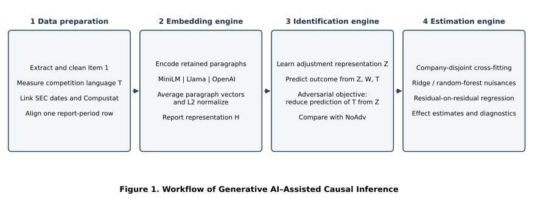
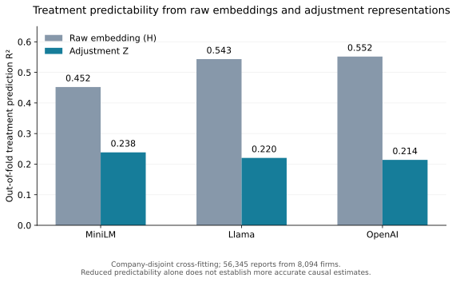
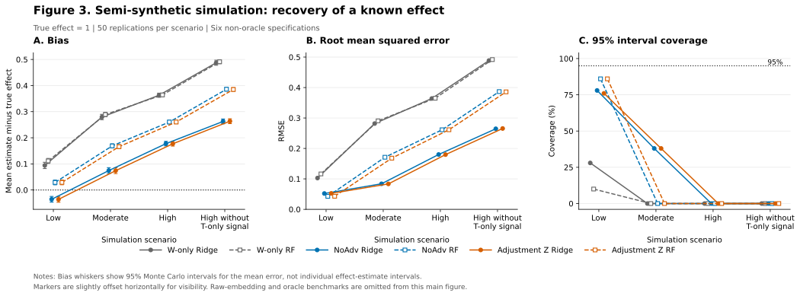

# Confounders in the Text
## Generative AI–Assisted Causal Inference for Organizational Research

Anonymous research artifact under preparation for peer review.

This project studies text-based adjustment for the relationship between competition language in business descriptions (Item 1) of 10-K filings and next-fiscal-year return on assets (ROA).

## Current release status

This repository contains four anonymized research notebooks for the three-encoder benchmarks and semi-synthetic simulation; a fully synthetic CPU estimator demonstration; reported aggregate main-sample and unrestricted-sample results; and runnable plotting scripts for Figures 1–3. The research notebooks require the existing authorized analysis sample and completed report embedding exports. Upstream extraction, embedding computation, SEC/financial linking, and analysis-sample construction are **not yet integrated**. Full neural training has not been rerun after packaging. This is a partial replication package.

The unrestricted analysis sample contains 56,345 reports from 8,094 companies. The extraction corpus contains 106,877 accepted reports. These are different populations. The current main analysis excludes the bottom 5% of report-period observations by current total assets and contains 53,527 reports from 7,679 companies. The unrestricted and 1% exclusion analyses are sensitivity comparisons.

## Quick start: reproduce the proposal figures

Python 3.10 or newer is recommended for this plotting-only example. From the repository root:

```bash
python -m venv .venv
# Windows PowerShell:
.venv\Scripts\Activate.ps1
# macOS/Linux alternative:
# source .venv/bin/activate
python -m pip install -r requirements-demo.txt
python scripts/plot_figure1.py
python scripts/plot_figure2.py
python scripts/plot_figure3.py
```

The scripts draw the workflow and read the frozen aggregate diagnostics/simulation summary, writing PNG, PDF, and SVG files to `outputs/figures/`. They do not train models or require financial data, an API key, or a GPU.

## Repository contents

- [Main Table 1](results/TABLE1.md) and [CSV](results/table1_asset_restricted.csv): 5%-restricted estimates and approximate confidence limits.
- [Unrestricted estimates](results/table1_full_sample.csv): preserved earlier 0% results.
- [Adjustment sensitivity comparison](results/asset_sensitivity_adjustment.csv): 0%, 1%, and 5% results.
- [Figure 2 input](results/figure2_treatment_diagnostics.csv): out-of-fold treatment prediction diagnostics.
- [Reproduction plan](REPRODUCIBILITY.md): workflow, inputs, and current availability.
- [Data access](DATA_AVAILABILITY.md): public-source and licensed-data dependencies.
- [Configuration template](configs/paths.example.json): portable input/output paths.
- [Run the research notebooks](docs/RUNNING_MODELS.md): local inputs, environment setup, and checkpoint behavior.
- [Technical appendix](docs/TECHNICAL_APPENDIX.md): benchmark, simulation, and industry methods.
- [Notebook manifest](docs/PACKAGE_MANIFEST.json): artifact checksums and adaptation scope.

## Fully synthetic CPU example

```bash
python -m pip install -r requirements-demo.txt
python scripts/run_synthetic_demo.py
python -m unittest discover -s tests
```

The example generates artificial data and compares observed-control adjustment with oracle adjustment. It verifies residual-estimation plumbing; it is not a comparison of the learned text methods or a reproduction of the empirical findings.

## Analysis overview

1. Extract and validate Item 1 paragraphs and sentences.
2. Measure competition language using a sentence-level adaptation of the competition word list and exclusion rule.
3. Encode paragraphs with MiniLM, a Llama-based embedding model, or OpenAI embeddings; aggregate paragraph vectors to report vectors.
4. Match SEC metadata using CIK and accession number.
5. Match financial periods, construct ROA and controls, and align representations by report identifier.
6. Fit company-grouped cross-fitted benchmarks and examine representation and influence diagnostics.
7. Evaluate known-effect recovery in semi-synthetic simulations. Industry variation is a development extension.

## Interpretation

Competition language is the share of retained Item 1 sentences satisfying the dictionary rules. It is not automatically a measure of an exogenous change in competitive conditions. Table 1 reports continuous-treatment slopes, not binary-treatment average effects. All six main-sample Adjustment Z approximate 95% intervals exclude zero and have positive point estimates. Unrestricted and 1% exclusion Adjustment Z estimates are negative and statistically inconclusive. Estimates are therefore sensitive to sample definition; significance does not establish greater causal accuracy. Reduced treatment predictability alone does not establish valid confounder adjustment.

## Anonymous review and licensing

Files in this package omit author names and institutional identifiers. The hosting account and Git commit metadata are separate from artifact anonymity. No code license or citation authorship is asserted in this initial version; a license and named citation will be added when approved by the authors.

## Proposal figures







See [proposal alignment](docs/PROPOSAL_ALIGNMENT.md) for scope and labels. Industry development is preserved on the `development-industry-extension` branch.
